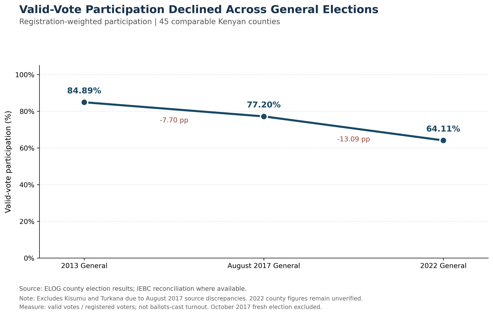
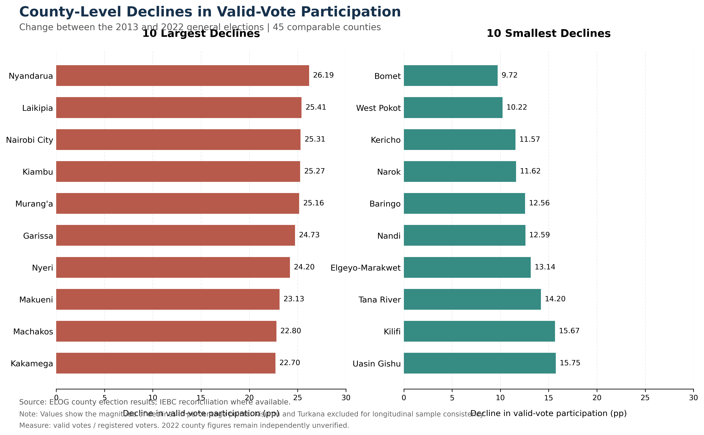
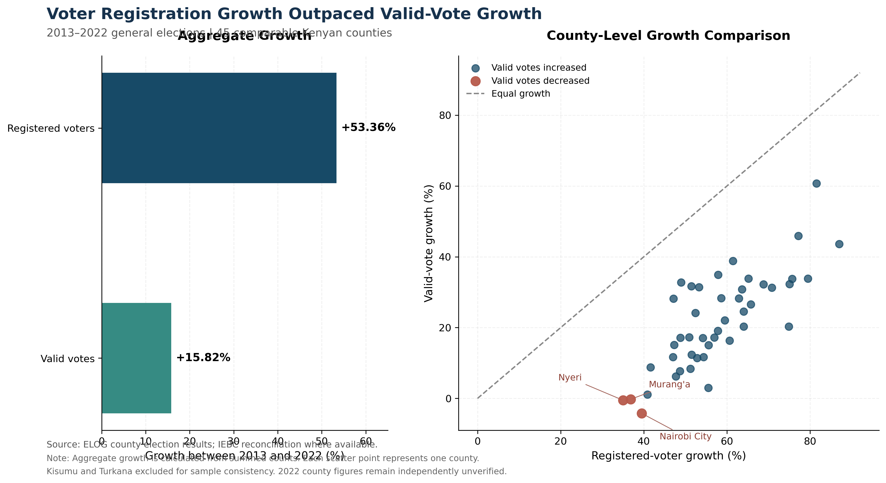
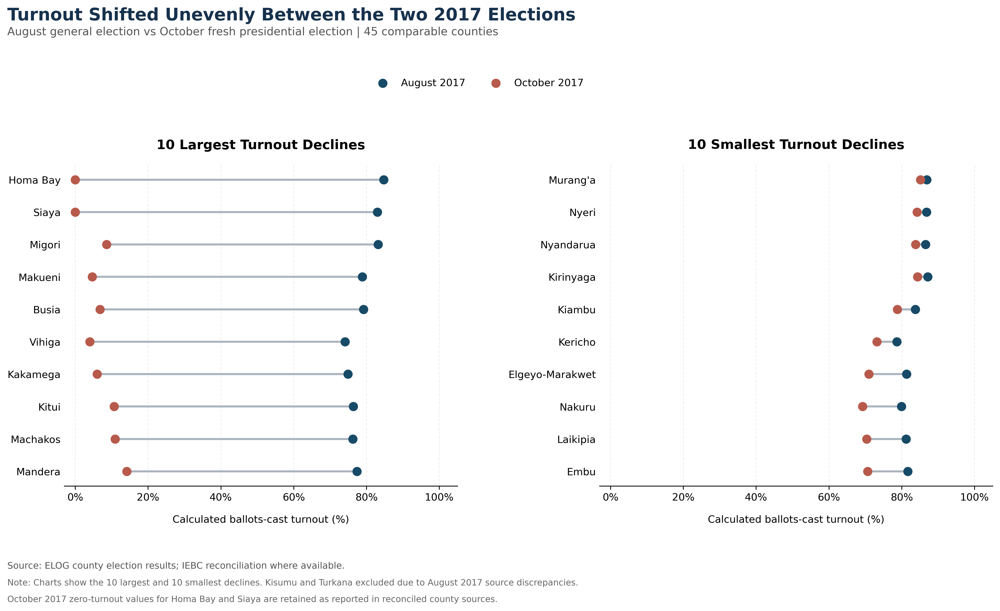
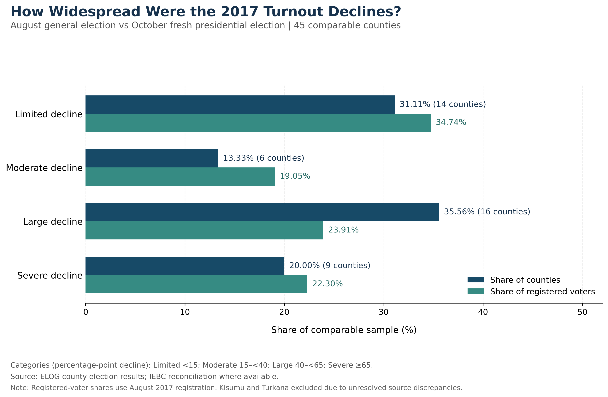

# Kenya Electoral Participation Analytics
## Notebook 05 — Visualisation and Findings Report

### 1. Executive Summary

This report examines electoral participation patterns
across Kenyan counties for the 2013, August 2017,
October 2017 and 2022 presidential election events.

The main longitudinal comparisons use a consistent
45-county sample.

Across this sample, registration-weighted valid-vote
participation declined from 84.89%
in 2013 to 64.11% in 2022.

This represents a decline of 20.78
percentage points.

Over the same period, registered voters increased by
53.36%, while valid votes
increased by 15.82%.

The findings indicate that growth in voter registration
was not accompanied by proportionate growth in valid votes.

### 2. General-Election Participation Trends

All 45 comparable counties recorded lower valid-vote
participation in 2022 than in 2013.

The unweighted mean county decline was
19.36 percentage points.

The registration-weighted aggregate decline was
20.78 percentage points.

These measures differ because the aggregate calculation
weights counties according to their registered electorates.

### 3. County-Level Variation

Nyandarua recorded the largest decline in valid-vote
participation between 2013 and 2022, at 26.19
percentage points.

Bomet recorded the smallest decline, at 9.72
percentage points.

The results demonstrate that participation declines
were widespread but varied in magnitude.

### 4. Registration Growth Versus Valid-Vote Growth

Across the 45 comparable counties:

- Registered-voter growth: 53.36%
- Valid-vote growth: 15.82%
- Counties with increased absolute valid votes: 42
- Counties with decreased absolute valid votes: 3

Nairobi City, Nyeri and Murang'a recorded fewer
absolute valid votes in 2022 than in 2013.

Registration growth exceeded valid-vote growth
in all 45 counties.

### 5. August–October 2017 Turnout Comparison

The October 2017 fresh presidential election is
analysed separately from the ordinary general elections.

All 45 comparable counties recorded lower calculated
ballots-cast turnout in October than in August 2017.

The mean county turnout decline was
39.09 percentage points.

Homa Bay recorded the largest decline at 84.71
percentage points.

Murang'a recorded the smallest decline at 1.71
percentage points.

The October 2017 zero-turnout values for Homa Bay
and Siaya are retained from reconciled county sources.

### 6. Distribution of 2017 Turnout Declines

Counties were grouped into four categories:

- Limited: less than 15 percentage points
- Moderate: 15 to less than 40 percentage points
- Large: 40 to less than 65 percentage points
- Severe: 65 percentage points or more

Large or severe declines affected
25 of the 45 comparable counties.

These counties represented
46.21% of registered voters
in the comparable August 2017 sample.

Registered-voter shares describe the distribution
of registered electors across categories, not
the number of people who abstained.

### 7. Methodological Limitations

1. The longitudinal comparisons use 45 counties,
   not the complete 47-county national electorate.

2. Kisumu and Turkana are excluded from comparisons
   requiring validated August 2017 participation
   because of documented source discrepancies.

3. The October 2017 fresh presidential election
   is treated as a separate electoral event.

4. The 2022 county figures are ELOG-derived and
   have not been independently reconciled against
   official county-level figures.

5. Valid-vote participation is calculated as
   valid votes divided by registered voters.
   It is not equivalent to ballots-cast turnout.

6. The analysis is descriptive. It does not
   establish the causes of participation changes.

7. The 2013 county registration figures have a
   documented difference from the IEBC national
   registration benchmark.

### 8. Validation and Reproducibility

Notebook 05 verified:

- 5 exported charts
- 9 analytical validation checks
- A consistent 45-county longitudinal sample

All checks passed.

The source reconciliation and detailed data
methodology are documented in Notebooks 02–04
and their associated documentation files.

### 9. Conclusion

The analysis identifies a persistent decline in
valid-vote participation across the comparable
general-election sample between 2013 and 2022.

At the same time, registered-voter counts grew
substantially faster than valid-vote counts.

The August–October 2017 comparison reveals
considerable county-level variation in turnout
during a distinct electoral event.

Together, these findings highlight the importance
of examining registration growth, absolute valid
votes, participation rates and geographical
differences as separate but related measures.
